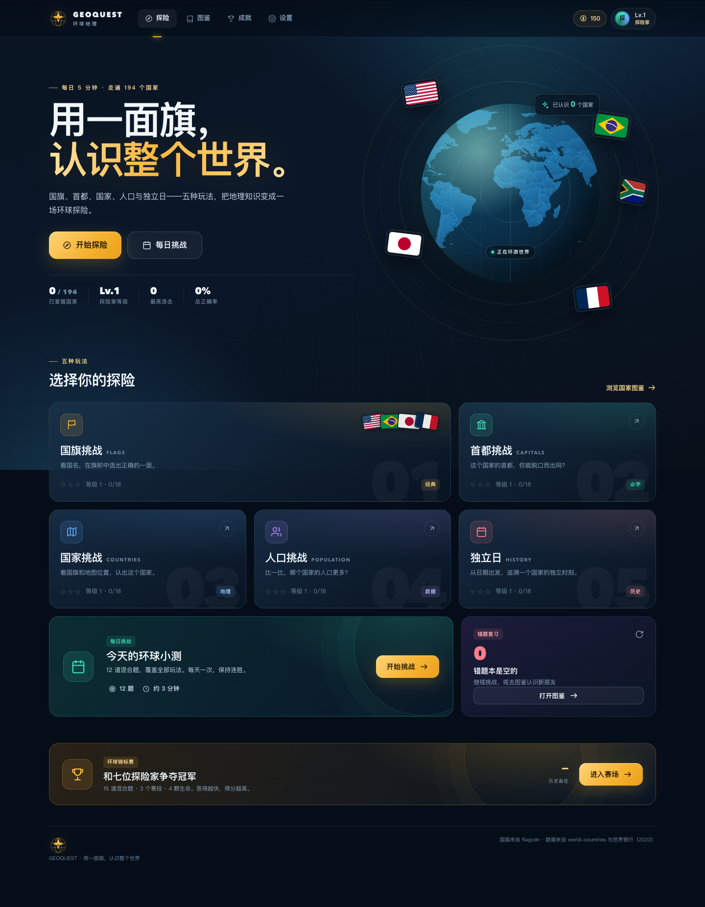
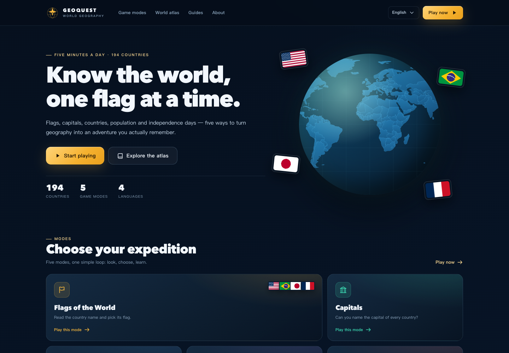
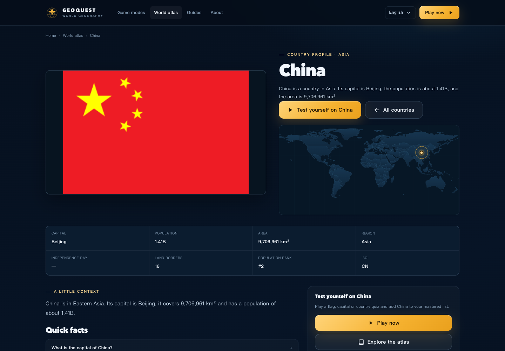
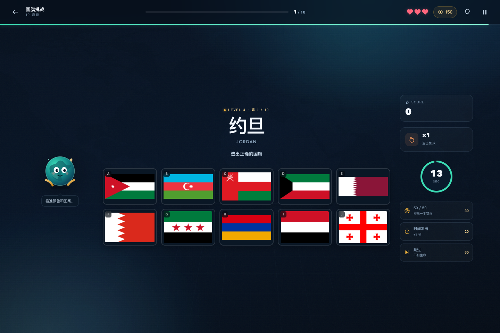
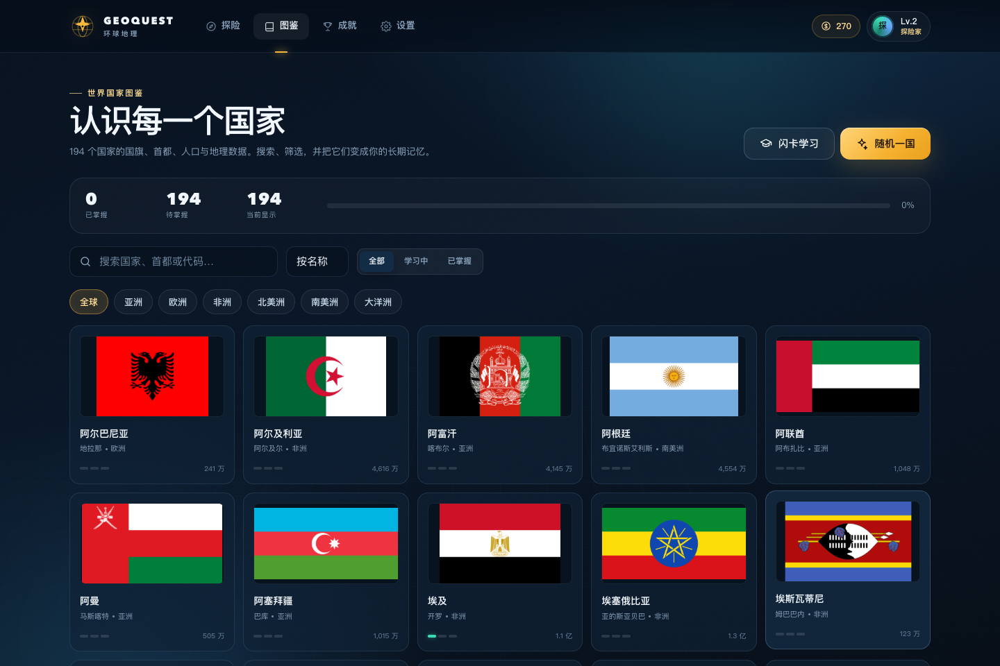
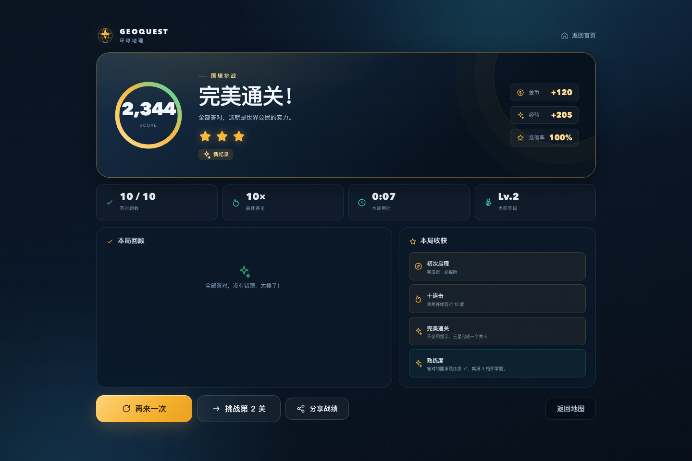
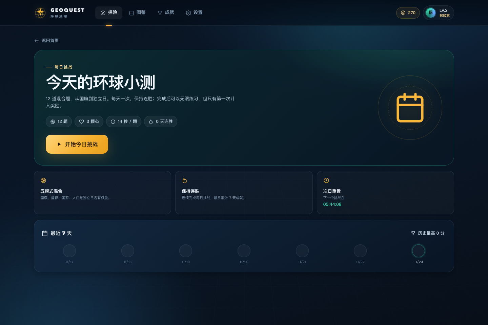
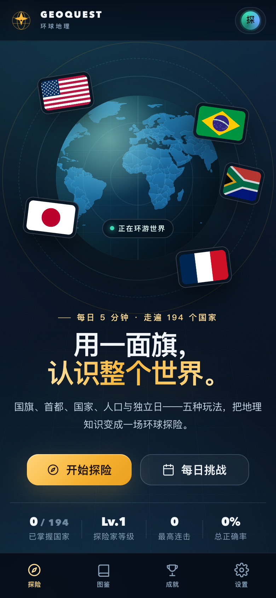
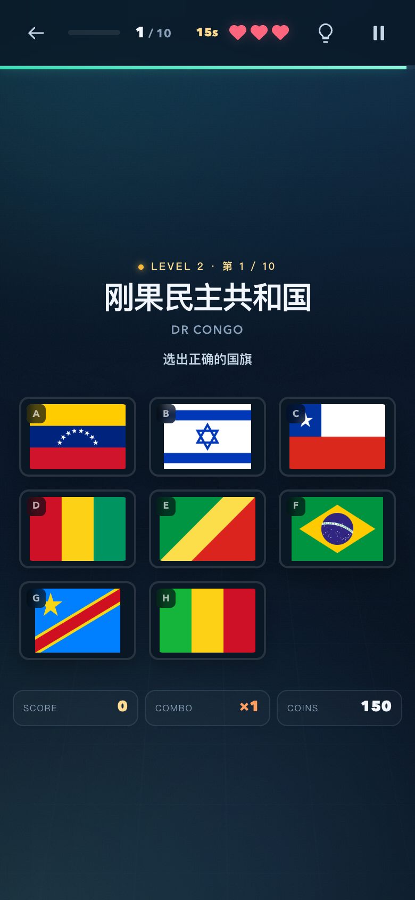

# GEOQUEST · 环球地理

> 用一面旗，认识整个世界。
> 对 CrazyGames《Geography Quiz: Flags and Capitals》的完整玩法复刻，并针对“学会”和“玩得舒服”做了系统优化。



---

## 快速开始

项目现在是 **静态 SEO 内容站 + 游戏 SPA** 两层：

```bash
# Node 18+
npm start                 # 开发：游戏仪表盘 http://127.0.0.1:8790
npm run build             # 生成 dist/：可索引内容页 + /play/ 游戏
npm run seo               # 单独重生成 sitemap.xml / robots.txt / ads.txt
npm run serve:dist        # 预览构建产物 http://127.0.0.1:8791
```

生产环境：

- `dist/{zh,en,es,fr}/`：首页、五种模式页、图鉴、194×4 国家页、指南、隐私/条款/关于/联系
- `dist/play/`：游戏应用（`noindex`，通过 `?lang=xx&mode=flags` 进入）
- `dist/sitemap.xml`、`dist/robots.txt`、`dist/ads.txt`
- 所有静态页使用 `History` 风格路径，游戏保持 hash 路由（不影响 SEO）

部署前改 `site.config.json` 的 `baseUrl`、`contactEmail` 和 AdSense 配置，然后运行 `npm run build`。

```json
{
  "baseUrl": "https://navpage.win",
  "contactEmail": "hello@your-domain.com",
  "adsense": {
    "enabled": true,
    "client": "ca-pub-6758251429919320",
    "autoAds": true,
    "slots": {
      "home": "",
      "mode": "",
      "atlas": "",
      "country": "",
      "guide": ""
    }
  }
}
```

把 `dist/` 整个目录部署到 HTTPS 根目录即可。`/{lang}/...` 是预渲染 HTML，
`/play/` 是游戏应用；不需要为内容页配置 SPA fallback。

首次打开后，PWA 会缓存核心资源；玩过的国旗也会被缓存，之后断网仍可继续。进度保存在浏览器 `localStorage`。

## Cloudflare 自动构建：Workers 或 Pages

你截图里的是 **Cloudflare Workers Builds**，不是 Pages 的创建界面。两种都能部署这个项目：

- 如果你已经在这个界面：按 **A. Workers Builds** 填；
- 如果你想用更简单的静态 Pages：按 **B. Pages** 填，然后从 Dashboard 重新创建 Pages 项目。

项目本身两种都支持：

- `package.json` 有 `build` 脚本；
- `.nvmrc` 固定 Node 22；
- 构建产物是 `dist/`（已加入 `.gitignore`，由 Cloudflare 构建）；
- 构建会生成 `dist/_headers`、`dist/_redirects`、`dist/404.html`；
- 游戏在 `/play/`，内容页是预渲染 HTML，不需要 SPA fallback；
- Workers 静态资源支持 `_headers` 和 `_redirects`，所以两套规则都能用。

---

### A. Workers Builds（对应你的截图）

仓库根目录已经有 [wrangler.jsonc](wrangler.jsonc)：

```jsonc
{
  "name": "geoquest",
  "compatibility_date": "2026-11-24",
  "assets": {
    "directory": "./dist",
    "not_found_handling": "404-page"
  }
}
```

它告诉 Wrangler：把 `dist/` 作为静态资源目录，并用 `404.html` 处理未命中路径。

按截图填：

| 字段 | 填什么 |
|---|---|
| 构建命令 | `npm run build` |
| 部署命令 | `npx wrangler deploy` |
| 预览命令 | 保持默认 `npx wrangler preview` |
| 启用预览构建 | 开（可选） |
| 使用 Cloudflare Access 保护 | 关（这是公开站点） |
| 根目录 | 留空 / 仓库根目录 |
| 生产分支 | `main` |

然后在 **Settings → Build → Build variables and secrets** 添加：

```text
SITE_BASE_URL=https://your-domain.com
```

可选但推荐：

```text
NODE_VERSION=22
```

说明：

- `wrangler.jsonc` 的 `name` 必须和 Cloudflare 里创建的 Worker 名称一致；如果你把项目命名为别的，改这里或改项目名。
- `npx wrangler deploy` 会读取 `wrangler.jsonc`，把 `dist/` 上传为静态资源。
- `npx wrangler preview` 是 Workers Builds 的默认预览命令，用来给非 `main` 分支生成 Preview URL；如果预览失败，可以在 Build 设置里改成 `npx wrangler versions upload`，或者先关闭预览构建。
- 自定义域名在 Worker 的 **Settings → Domains & Routes** 里绑定。
- `dist/_headers`、`dist/_redirects`、`dist/404.html` 由构建脚本自动生成，Workers 会消费它们。

---

### B. Cloudflare Pages

Cloudflare Dashboard → **Workers & Pages** → **Create** → **Pages** → **Connect to Git**，
选择仓库，然后填：

| 配置 | 值 |
|---|---|
| Framework preset | None |
| Build command | `npm run build` |
| Build output directory | `dist` |
| Root directory | 仓库根目录（本项目就是根目录） |
| Node version | 由 `.nvmrc` 指定 22；也可加 `NODE_VERSION=22` |

Pages 的环境变量同样加：

```text
SITE_BASE_URL=https://your-domain.com
```

Pages 会自动识别 `_headers`、`_redirects`、`404.html`，不需要 `wrangler.jsonc`。
自定义域名在 Pages 项目的 **Custom domains** 里绑定。

---

### 共同步骤

1. 推到 GitHub：

```bash
git remote add origin git@github.com:<you>/<repo>.git
git push -u origin main
```

2. 连接 Cloudflare，按 A 或 B 填构建配置；
3. 加 `SITE_BASE_URL`；
4. 绑定域名；
5. 在 `site.config.json` 填 `contactEmail` 和 AdSense 配置，push 自动重新构建；
6. 确认 `https://your-domain.com/ads.txt` 可访问；
7. Search Console 提交 `sitemap.xml`。

### 注意事项

- **不要开启 Rocket Loader**：它可能干扰 AdSense 与游戏脚本；
- 保留 Google `Googlebot` / `AdsBot-Google` / `Mediapartners-Google` 的访问，
  不要用 WAF / Bot Fight Mode 误伤 AdSense 爬虫；
- `_headers` 已为 `sw.js` 设置 `no-cache`，避免 Service Worker 旧缓存；
- `_redirects` 会把 `/play`、`/zh` 等无斜杠路径 301 到带斜杠目录；
- 构建产物约 15MB、约 1,900 个文件，仍远低于 Workers/Pages 的 20,000 文件限制；
- GitHub 只负责源码托管；Cloudflare 负责构建与发布，不需要额外 GitHub Actions。

## sitemap / robots / ads.txt 工具

域名已设置为 **https://navpage.win**。`npm run build` 会自动生成：

```text
dist/sitemap.xml   仅含可索引页，含四语言 hreflang
dist/robots.txt    允许抓取，声明 sitemap
dist/ads.txt       AdSense 授权文件
```

也可以单独重新生成，不必全量构建：

```bash
# 使用 site.config.json 里的域名
npm run seo

# 改域名
npm run seo -- --domain https://navpage.win

# 接入 AdSense：填真实发布商 ID
npm run seo -- --domain https://navpage.win --ads-client ca-pub-XXXXXXXXXXXXXXXX

# 输出到其他目录
npm run seo -- --out /tmp/seo-test
```

工具文件：

- [scripts/seo_files.mjs](scripts/seo_files.mjs)：唯一的生成逻辑，build 和 CLI 共用；
- [scripts/generate_seo_files.mjs](scripts/generate_seo_files.mjs)：命令行入口。

`ads.txt` 只有在传入真实 `pub-...` 后才会写入正式授权行；没有 ID 时只写注释占位，
不会伪造发布商 ID。

> 产品分析见 **[docs/analysis.md](docs/analysis.md)**；SEO/广告路线见 **[docs/seo-ads-roadmap.md](docs/seo-ads-roadmap.md)**。

---

## 一、原版拆解

原版是 Fire Flour 开发的 Unity 6 WebGL 地理问答游戏：

- **五种模式**：Flags of the World（看国名选国旗）、Independence Day（历史日期）、
  Countries of the World（国家）、Population of Countries（人口）、Tournaments（锦标赛）。
- **单局结构**：60 秒总计时 + 3 颗心 + 金币 + 关卡等级；答错扣心，心用完结束。
- **答题 UI**：题目卡片 + 左侧卡通角色 + 底部横向国旗轮播 + 50/50 提示。
- **商业化**：金币、提示、多语言、移动端、CrazyGames 平台。
- **为什么有效**：
  - 国旗是强视觉刺激，认知门槛低，适合“5 分钟一局”；
  - 计时 + 生命 + 连击构成轻量张力；
  - 五种模式用同一套核心操作，内容复用率高；
  - 即时对错反馈带来多巴胺循环。

### 但它也有明显可优化点

| 原版体验 | 问题 | 机会 |
|---|---|---|
| 60 秒总计时 + 3 条命 | 双重惩罚，读题慢的人直接被时间压垮 | 改为每题独立倒计时，保留生命惩罚 |
| 答错只显示正确答案 | 知识留存弱，玩完就忘 | 错题进入复习队列 + 熟练度 + 闪卡 |
| 10 个国旗横向轮播 | 选项藏在屏幕外，容易漏看 | 桌面 5×2 / 移动 3 列网格，全部可见 |
| 只有关卡，没有学习区 | 玩家不知道“我学到了什么” | 194 国图鉴、搜索、区域掌握度 |
| 没有每日/长期目标 | 次日留存弱 | 每日挑战、连胜、锦标赛、成就 |
| 缺少错题沉淀 | 同一个国家反复错 | 错题本 + 优先出题 + 答对移除 |
| 无障碍与键盘支持有限 | 桌面/特殊需求用户体验一般 | 全键盘、ARIA、减少动效、色彩非唯一信号 |
| 语言数量多但缺少双语对照 | 非英语玩家记英文名困难 | 中文 / English / Español / Français 四语言界面 + 双语副标题 |

---

## 二、复刻范围

| 原版模式 | GEOQUEST 对应 | 玩法 |
|---|---|---|
| Flags of the World | **国旗挑战** | 看国名，从 6/8/10 面国旗中选出正确的一面 |
| Capitals（原版核心能力） | **首都挑战** | 看国家，从 4 个首都中作答 |
| Countries of the World | **国家挑战** | 看国旗 + 世界地图定位点，猜国家 |
| Population of Countries | **人口挑战** | 四个国家中选出人口最多/最少 |
| Independence Day | **独立日** | 看日期，选出当天庆祝独立的国家 |
| Tournaments | **环球锦标赛** | 15 题、3 赛段、4 颗心、8 人排名 |
| — | **每日挑战** | 每天固定 12 题，连胜与历史成绩 |
| — | **错题复习** | 从错题本抽题，答对移除、熟练度 +1 |
| — | **闪卡学习** | 20 张卡，先翻面记忆再自评 |
| — | **国家图鉴** | 194 国搜索、筛选、详情、掌握标记 |

数据：**194 个独立国家**（world-countries 的 independent 集合），
国旗 320px PNG 共 194 面，世界地图为 TopoJSON 离线渲染的 SVG。

### 与原版的取舍

- **核心循环一致**：看题 → 选答案 → 即时反馈 → 生命/分数 → 下一题 → 结算；
- **视觉与代码完全原创**：没有使用原版 Unity 美术、音频或代码；
- **计时改为每题独立**：保留紧张感，同时降低“读题慢就出局”的挫败；
- **把“首都”独立成模式**：原版页面把首都作为核心能力之一，这里给它完整关卡；
- **新增每日/复习/闪卡/图鉴**：把一次性 quiz 变成可积累的学习工具；
- **语言为中文/English/Español/Français**：原版支持 15 种，本项目优先把四语体验做完整；
- **纯前端本地存档**：无账号、无后端、无全球排行榜，但可导出/导入。

---

## 三、体验优化清单

### 1. 核心玩法

- **每题独立计时**（16s → 10s 随关卡收紧），不再用 60 秒总时长惩罚读题；
- **生命值 3 颗**（复习 5 颗、锦标赛 4 颗），答错或超时扣 1 颗；
- **连击倍率**：连续答对提高得分与金币，答错重置；
- **时间加成**：剩余时间越多，单题得分越高；
- **难度曲线 6 关**：入门 → 漫游 → 深入 → 挑战 → 极限 → 大师；
  出题池按国家知名度分层，高关卡优先同地区/同子地区的“迷惑选项”；
- **选项数量随难度增加**：国旗模式 6 → 8 → 10 面；
- **全部选项可见**：桌面 5×2 网格、移动 3 列网格，避免横向轮播漏项；
- **三种提示**：50/50、时间冻结 +8s、跳过（不扣生命），每局消耗金币。

### 2. 学习闭环（原版最缺的部分）

- **即时知识卡**：每题答完展示首都、人口、面积、地区、独立日和一条小知识；
- **熟练度 0–3**：答对 +1、答错 -1，3 格为“已掌握”；
- **错题本**：答错自动收集，复习答对后移除；主页显示待复习数量；
- **闪卡模式**：先看国旗回忆，再翻面看答案；认识/不熟会更新熟练度；
- **国家图鉴**：194 国可搜索、按大区筛选、按人口/面积/熟练度排序；
- **地图定位**：国家模式显示世界地图光点，让“国家”不只是文字；
- **双语对照**：中文界面显示英文名，英文界面显示中文名，强化记忆。

### 3. 长期目标与留存

- **每日挑战**：按日期固定种子，12 道混合题，每日一次计入奖励；
- **每日连胜**：连续完成累计天数，7 天成就；
- **锦标赛**：3 赛段、4 生命、10 秒/题、AI 对手 8 人榜；
- **成就系统**：13 个里程碑，覆盖答题量、连击、完美通关、图鉴掌握、锦标赛等；
- **玩家等级 / XP / 金币**：每答对、每通关、每日/锦标赛奖励；
- **关卡星级**：1–3 星，1 星解锁下一关，失败不解锁；
- **新纪录 / 升级提示**：结果页明确反馈。

### 4. 体验与无障碍

- 全键盘操作：`1–9` / `A–J` 选答案、`← →` 滚动、`Space` 继续、`?` 提示、`Esc` 暂停；
- 暂停 / 自动暂停（切后台）、退出确认、暂停计时；
- 移动端底部 Tab、横屏单屏布局、竖屏网格布局；
- 色彩 + 图标双通道反馈（对错不仅靠红绿）；
- `prefers-reduced-motion` 与游戏内“减少动效”开关；
- 中英双语、数字本地化、日期本地化；
- PWA：可安装、离线缓存、首页启动；
- 音效由 WebAudio 合成，无外部音频资源；
- 设置页支持导出/导入 JSON 存档、重置进度。

---

## 四、SEO 与多语言（已实现）

当前结构不是“一个客户端 SPA 撑起全站”，而是：

```text
/{zh,en,es,fr}/            静态 HTML，可被抓取
  ├── /                    首页
  ├── /flags/ /capitals/   五种模式介绍页
  ├── /atlas/              图鉴索引
  ├── /atlas/cn/           194 个国家详情页（含手写亮点）
  ├── /guides/...          8 篇指南（四语言）
  └── /privacy/ /terms/    合规页
/play/                     游戏 SPA（noindex）
```

每个静态页有：

- 独立 title / description / canonical
- 四语言 `hreflang` + `x-default`
- Open Graph / Twitter Card
- `WebApplication`、`FAQPage`、`BreadcrumbList`、`Country` 等 JSON-LD
- 面包屑、相关国家/模式内链、CTA 到游戏
- `sitemap.xml` 仅含可索引页，`robots.txt`

构建产物：

```bash
npm run build
# 857 indexable pages, app: /play/ (noindex)
```

### 多语言

- UI、国家名、首都、地区、数字、日期、面积、人口均为四语言；
- 语言由 URL 决定：`/zh/`、`/en/`、`/es/`、`/fr/`；
- **根路径 `/` 自动按浏览器语言跳转**：支持 `zh` / `en` / `es` / `fr`，不支持时默认 `/en/`；
- 用户手动选过语言后保存到 `localStorage`，下次访问 `/` 或 `/play/` 优先使用该语言；
- 想强制查看语言选择页，用 `/?choose=1`（自动跳转不会触发）；
- 游戏入口 `?lang=es`，语言切换写回 URL；
- 翻译集中在 `js/locales/es.js`、`js/locales/fr.js`，以及 `site/content.mjs`。

### AdSense 展示广告

当前已配置发布商 ID：

```text
ca-pub-6758251429919320
```

采用 **Auto ads（自动广告）**：

1. `adsense.enabled: true`；
2. `adsense.client: "ca-pub-6758251429919320"`；
3. `adsense.autoAds: true`；
4. 在 AdSense 后台开启 Auto ads；
5. 重新 `npm run build`；
6. `ads.txt` 会自动写入正式授权行。

AdSense 官方脚本直接写进每个内容页的 `<head>`，前面是一条 Consent Mode v2 默认值（全部 `denied`）：

```html
<script>gtag('consent','default',{ad_storage:'denied',ad_user_data:'denied',ad_personalization:'denied',analytics_storage:'denied',wait_for_update:500});</script>
<script async src="https://pagead2.googlesyndication.com/pagead/js/adsbygoogle.js?client=ca-pub-6758251429919320"
        crossorigin="anonymous"></script>
```

脚本必须常驻，审核抓取器才会认到代码；是否允许 Cookie / 个性化由 Consent Mode 控制。
用户接受后 `js/site.js` 发 `consent update`；拒绝后仍可玩，只出非个性化广告。

如果之后创建了手动广告单元，把 `slots` 填上，静态内容页就会出现手动广告位；游戏页仍然保持无广告。

> **EEA/UK/CH**：个性化广告必须使用 Google 认证 CMP。在 AdSense 后台启用 Funding Choices（GDPR 消息），
> 然后把 `site.config.json` 的 `adsense.cmp` 改为 `"google"`，自带横幅会自动让位。
> 完整接入清单见 **[docs/adsense-setup.md](docs/adsense-setup.md)**。

---

## 五、技术架构

```text
geography/
├── index.html              # game app shell (source, /play/ in dist)
├── site.config.json        # baseUrl, contact email, AdSense IDs
├── wrangler.jsonc          # Workers 静态资源配置（dist + 404）
├── manifest.webmanifest
├── sw.js
├── package.json
├── css/
│   ├── base.css            # tokens / reset / buttons / background
│   ├── components.css      # game shell / home / cards / atlas / modal
│   ├── game.css            # game screen / answers / feedback / result
│   └── site.css            # SEO content pages + ad slots
├── js/
│   ├── main.js             # hash router + boot + ?lang/?mode + PWA
│   ├── data.js             # generated: 194 countries × 4 languages
│   ├── modes.js            # 5 modes + 6 level curve + 4-language labels
│   ├── engine.js           # question generation + scoring + run lifecycle
│   ├── store.js            # localStorage + progress + achievements
│   ├── i18n.js             # zh/en/es/fr switch
│   ├── locales/            # es.js / fr.js UI dictionaries
│   ├── utils.js            # localized formatting / RNG / map markers
│   ├── audio.js            # WebAudio SFX + ambient loop
│   ├── ui.js               # toast / modal / confirm / confetti
│   ├── icons.js            # inline stroke icon set
│   ├── layout.js           # app shell / topbar / mobile tabs
│   ├── site.js             # static-site search + AdSense consent
│   └── views/              # home / play / game / result / atlas / ...
├── site/
│   └── content.mjs         # 4-language static-site copy
├── data/
│   ├── capitals-i18n.json  # Spanish/French capital labels
│   ├── en-strings.json     # UI source strings
│   └── translations-*.json # generated ES/FR dictionaries
├── assets/
│   ├── flags/              # 194 × PNG
│   ├── world-map.svg       # generated from world-atlas
│   ├── favicon.svg
│   └── icon-192.png / icon-512.png
├── docs/
│   ├── screenshots/
│   ├── analysis.md
│   └── seo-ads-roadmap.md
├── scripts/
│   ├── build_data.py       # world-countries + World Bank → js/data.js
│   ├── build_map.py        # world-atlas TopoJSON → assets/world-map.svg
│   ├── build_site.mjs      # static pages + dist/play/ + sitemap
│   ├── seo_files.mjs       # sitemap / robots / ads.txt generator
│   ├── generate_seo_files.mjs # npm run seo CLI
│   ├── serve.mjs           # dev / dist server (keep-alive)
│   └── serve.py            # fallback static server
└── dist/                   # generated deployment output
```

**设计原则**

- 游戏本身零运行时依赖、零构建步骤；内容站由 `build_site.mjs` 预渲染；
- 数据与视图分离：题目生成 / 计分只在 `engine.js`，视图不硬编码规则；
- 状态集中在 `store.js`，所有进度可序列化、可导出；
- 所有国旗本地化，避免游戏过程中依赖第三方 CDN；
- 纯前端，无账号、无后端、无追踪。

**评分模型（简化）**

```text
单题得分 = (100 + 剩余秒数 × 4) × 关卡倍率 × (1 + 连击 × 0.08) × 提示折扣
关卡倍率 = 1.0 → 1.6
金币     = 4 + min(连击, 5)   （答对）
星级     = ≥90% 三星 / ≥70% 二星 / ≥40% 一星；生命归零则 0 星
```

---

## 六、数据与内容

- **国家**：[world-countries](https://github.com/mledoze/countries)（ISO 代码、首都、面积、地区、翻译）；
- **人口**：世界银行 2023 年 `SP.POP.TOTL`；梵蒂冈使用约 800 人的估算值；
- **国旗**：[flagcdn](https://flagcdn.com) 320px PNG；
- **世界地图**：[world-atlas](https://github.com/topojson/world-atlas) 110m TopoJSON，
  在构建脚本中投影为 equirectangular SVG；
- **独立日**：人工整理的 154 个有明确独立日期的国家，日期按公历；
- **难度分层**：按人口/面积/知名度计算 fame score，排序后分为 3 档。

数据准确性的边界：

- 只覆盖 194 个 `independent` 国家，不包含属地、观察员国、特殊地区；
- 少数首都存在“法定首都/实际政府所在地”差异（如南非、玻利维亚、荷兰），
  项目使用国际通用的单一首都并以知识卡补充；
- 独立日并非所有国家都有“独立”概念，因此只纳入了有明确日期的国家；
- 人口为 2023 年统计，可能与最新估算有差异。

重新生成数据（需要先准备 world-countries 与 World Bank 原始 JSON）：

```bash
python3 scripts/build_data.py
python3 scripts/build_map.py
```

---

## 七、截图

| | |
|---|---|
|  |  |
| 静态内容首页：可抓取 HTML + 多语言 | 国家详情页：数据、地图、FAQ、内链 |
|  |  |
| 国旗挑战：10 个选项 5×2 全可见 | 国家图鉴：搜索 / 筛选 / 掌握度 |
|  |  |
| 结算：星级 / 正确率 / 错题 / 成就 | 每日挑战：固定种子 / 连胜 / 倒计时 |
|  |  |
| 移动端游戏首页 | 移动端游戏：3 列国旗网格 |

更多截图见 `docs/screenshots/`。

---

## 八、测试与验收

已在 Chrome（桌面 1440×960 / 移动 390×844 / 横屏 844×390）走查：

- 五种模式 + 每日 + 锦标赛 + 错题复习 + 闪卡 + 图鉴；
- 每题计时重置、超时扣心、冻结 +8s、50/50 排除、跳过不扣心；
- 生命耗尽 → 结算页，失败不解锁下一关；
- 满分通关 → 三星、成就、等级提升、下一关；
- 每日挑战固定种子、完成状态、连胜、历史最高分；
- 锦标赛 15 题、赛段文案、AI 8 人排名；
- 错题 → 复习 → 答对移除 → 掌握度更新；
- 四语切换、键盘操作、暂停/自动暂停、PWA 离线；
- 导出/导入存档、重置进度；
- 四语言（zh/en/es/fr）UI、国家名、首都、数字/日期/面积；
- `dist/` 可索引页面、hreflang、canonical、JSON-LD、sitemap；
- 静态站搜索/地区筛选、移动端导航；
- AdSense 发布商 ID、Auto ads、同意横幅、正式 `ads.txt`。

无浏览器控制台错误。

---

## 九、已知边界 / 下一步

- **AI 对手是本地模拟**，不是在线多人；排行榜为本机生成；
- **游戏页保持无广告**，AdSense 展示广告只在静态内容页；若要在游戏内变现，下一步接 GAM rewarded/interstitial；
- **EEA/UK 合规**：自定义同意横幅不是 Google 认证 CMP，面向 EEA/UK 前必须接入认证 CMP + Consent Mode v2；
- **语言做了中文/English/Español/Français**，原版有 15 种；新增语言需要补 `js/locales` 和 `site/content.mjs`；
- **国家模式用地图定位点**，不是精确国界轮廓；下一步可加入 194 国 SVG 轮廓；
- **无后端**，无法做全球排行榜 / 账号同步；
- **数据为离线快照**，可替换 `js/data.js` 或接 API；
- 下一步优先：在线排行榜、更多语言、国家轮廓题、错题间隔重复（SRS）算法。

---

## 十、操作

| 操作 | 桌面 | 移动 |
|---|---|---|
| 选择答案 | `1–9` / `A–J` / 点击 | 点击 |
| 滚动国旗 | `← →` | 滑动（竖屏为网格） |
| 继续 | `Space` / `Enter` | 点击“继续” |
| 提示 | `?` / 灯泡按钮 | 灯泡按钮 |
| 暂停 | `Esc` / 暂停按钮 | 暂停按钮 |
| 搜索图鉴 | `/` | 点击搜索框 |

---

## 十一、许可与致谢

- 玩法灵感：Fire Flour 的《Geography Quiz: Flags and Capitals》；
- 本项目为独立实现，未使用原版美术、音频或代码；
- 国旗来自 flagcdn，国家数据来自 world-countries，人口来自世界银行；
- 世界地图基于 world-atlas（Natural Earth 数据）；
- 图标为手写内联 SVG，音效由 WebAudio 合成。

---

**GEOQUEST · 用一面旗，认识整个世界。**
